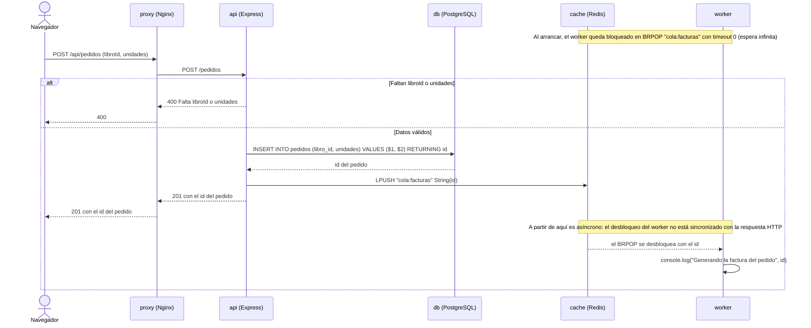

# Práctica 2 (UT2) — Analizar una arquitectura con un agente

**Aplicación analizada:** tienda-libros (`recursos/tienda-libros/`) · **Herramienta:** OpenCode (modo Plan, configuración de solo lectura) · **Método:** cada afirmación está contrastada contra los ficheros y se cita como `fichero:línea`.

---

## Ejercicio 1 — Agente en solo lectura

### Configuración usada (`opencode.json`)

```json
{
  "$schema": "https://opencode.ai/config.json",
  "permissions": [
    { "action": "edit", "resource": "*", "effect": "deny" },
    { "action": "shell", "resource": "*", "effect": "ask" }
  ],
  "share": "disabled"
}
```

- `edit: deny` → el agente no puede crear ni modificar ficheros: cualquier intento de edición se rechaza.
- `shell: ask` → cada comando de consola requiere confirmación del usuario.
- `share: disabled` → la sesión no se comparte fuera.

### Resumen de la aplicación (respuesta del agente, verificada)

tienda-libros es una pequeña tienda de libros de ejemplo, desplegada con Docker Compose como 5 servicios contenerizados: frontend estático servido por Nginx, API, worker de facturas, PostgreSQL y Redis.

| Servicio | Imagen / build | Qué hace |
|---|---|---|
| `proxy` | `nginx:1.27-alpine` | Sirve `web/` como contenido estático y redirige `/api/` a `api:3000` (`nginx/default.conf`) |
| `api` | build `./api` (Node 20) | API Express: `GET /salud`, `GET /libros` (con caché) y `POST /pedidos` (`api/src/server.js`) |
| `worker` | build `./worker` (Node 20) | Consume la cola Redis `cola:facturas` y «genera» la factura (solo `console.log`, `worker/worker.js`) |
| `db` | `postgres:16-alpine` | Guarda libros y pedidos; `db/init.sql` crea las tablas y siembra 3 libros |
| `cache` | `redis:7-alpine` | Caché de libros (60 s) y cola de facturas; persistencia `save 60 1` |

Comportamiento clave:

- **`GET /libros`**: primero consulta la caché (clave `libros`); si la hay, responde sin tocar la BD; si no, consulta Postgres (`ORDER BY id`) y cachea 60 s (`api/src/server.js:14-20`).
- **`POST /pedidos`**: valida datos, inserta el pedido en la BD y hace `LPUSH` de su id en `cola:facturas` (`api/src/server.js:22-31`).
- **Worker**: `BRPOP` bloqueante sobre la cola; por cada id registra `Generando la factura del pedido <id>` (`worker/worker.js:8-11`). No habla con la API ni con la BD: la comunicación es asíncrona vía Redis.
- **Frontend**: `web/index.html` es HTML+JS estático que hace `fetch('/api/libros')` y pinta la lista.

Red, puertos y volúmenes:

- Solo **1 de los 5** servicios es accesible desde fuera: el proxy publica `8080:80` (`docker-compose.yml:4-5`). API (3000), Postgres (5432) y Redis (6379) solo existen en la red interna de Compose.
- Arranque: `proxy → api`; `api → db (service_healthy)` y `cache`; `worker → cache`. Healthcheck de la BD con `pg_isready` (`docker-compose.yml:45-49`).
- Persistencia en los volúmenes `datos-db` y `datos-cache`; montajes de solo lectura para config, web e `init.sql`.

Configuración y secretos: `POSTGRES_PASSWORD` y `JWT_SECRET` llegan por variables de entorno desde un `.env` (en el repositorio solo está la plantilla `.env.example`); `DATABASE_URL` y `REDIS_URL` se construyen en `docker-compose.yml`.

Comprobaciones destacadas:

- `jsonwebtoken` está declarado (`api/package.json:13`) y `JWT_SECRET` se inyecta (`docker-compose.yml:20`), pero **no se usan**: no hay autenticación implementada.
- El worker **no genera facturas reales**: solo escribe en el log.
- El proyecto **no tiene** `.gitignore`, ni README, ni tests.
- Las rutas de la API no tienen manejo de errores (sin `try/catch`).

### ¿Por qué conviene un agente de solo lectura en la fase de análisis?

- El análisis consiste en **observar y describir**: cualquier escritura contamina el objeto de estudio.
- Evita cambios accidentales o «arreglos» no pedidos que habría que revisar y deshacer.
- Separa responsabilidades: el agente **propone**, la persona **decide y aplica** (git como red de seguridad, mejor no necesitarla).
- Reduce riesgos: sin escritura no hay comandos destructivos ni toques a secretos.
- La evidencia (respuestas, diagramas) describe exactamente el estado real del código.
- Obliga a prompts precisos y a verificar, porque el agente no puede «salir del paso» editando.

Durante esta práctica el agente no modificó ningún fichero de la aplicación: todas las respuestas del análisis son descriptivas y la configuración `edit: deny` bloquea cualquier edición.

---

## Ejercicio 2 — Inventario de componentes

5 servicios en `docker-compose.yml`, comprobados celda a celda:

| Servicio | Imagen / construcción | Puerto publicado al exterior | Puerto interno | Volúmenes | Depende de | Qué hace |
|---|---|---|---|---|---|---|
| `proxy` | imagen `nginx:1.27-alpine` | **8080 → 80** | 80 | `./nginx/default.conf` (ro), `./web` (ro) | `api` | Frontend estático + reverse proxy: `/api/` → `api:3000` |
| `api` | build `./api` (node:20-alpine) | ninguno | 3000 | ninguno | `db` (healthy), `cache` | API Express: `/salud`, `/libros` (caché), `/pedidos` (BD + cola) |
| `worker` | build `./worker` (node:20-alpine) | ninguno | ninguno (no escucha) | ninguno | `cache` | Consume `cola:facturas` (`BRPOP`) y «genera» la factura (solo log) |
| `db` | imagen `postgres:16-alpine` | ninguno | 5432 | `datos-db` → `/var/lib/postgresql/data`; `./db/init.sql` (ro) | ninguno | BD (libros, pedidos) + healthcheck `pg_isready` |
| `cache` | imagen `redis:7-alpine` | ninguno | 6379 | `datos-cache` → `/data` | ninguno | Caché de libros + cola de facturas; `save 60 1` |

Evidencias (fichero:línea):

- **proxy**: imagen `docker-compose.yml:3`; `ports: "8080:80"` `:4-5`; volúmenes `:6-8`; `depends_on: api` `:9-10`; `proxy_pass http://api:3000/` `nginx/default.conf:13`; sirve el HTML en `default.conf:5`.
- **api**: `build: ./api` `:14`; `PORT: 3000` `:17`; `DATABASE_URL` con `db:5432` `:18`; `REDIS_URL` `:19`; `depends_on` con `service_healthy` `:21-25`; `EXPOSE 3000` `api/Dockerfile:6`; rutas en `api/src/server.js:12-31`.
- **worker**: `build: ./worker` `:29`; `depends_on: cache` `:32-33`; `BRPOP` `worker/worker.js:9`; log `:10`.
- **db**: imagen `:37`; volúmenes `:42-44`; healthcheck `:45-49`; esquema y semilla `db/init.sql:1-18`.
- **cache**: imagen `:53`; `--save 60 1` `:54`; volumen `:55-56`; usos en `api/src/server.js:18` (caché) y `:29` (cola).

**¿Cuántos servicios son accesibles desde fuera del equipo?** Solo **1 de 5: el `proxy`**.

- Es el único que declara `ports` (`docker-compose.yml:4-5`): publica el 80 del contenedor en el 8080 del host (en todas las interfaces, por defecto).
- Los demás no publican puertos: solo son alcanzables dentro de la red interna de Compose (por nombre de servicio: `api`, `db`, `cache`).
- Matiz: publicar ≠ escuchar. Que un proceso escuche no lo hace accesible desde fuera; eso lo decide el mapeo `ports`.

---

## Ejercicio 3 — Recursos de la aplicación

Clasificación de los recursos del proyecto:

| Recurso | Categoría | Dónde vive / quién lo usa | ¿Al repositorio? |
|---|---|---|---|
| `web/index.html` | Contenido estático | Servido por `proxy` desde `./web` → `/usr/share/nginx/html` (`docker-compose.yml:8`) | Sí |
| `api/src/server.js` | Código de servidor | Imagen `api` (`api/Dockerfile:5`) | Sí |
| `worker/worker.js` | Código de servidor | Imagen `worker` (`worker/Dockerfile:5`) | Sí |
| `db/init.sql` | Esquema y datos de ejemplo | Lo ejecuta `db` solo la primera vez (`docker-compose.yml:44`) | Sí (esquema y 3 libros de ejemplo) |
| Volumen `datos-db` | Datos | Datos reales de PostgreSQL en runtime (gestionado por Docker, fuera del proyecto) | No |
| Volumen `datos-cache` | Datos | Persistencia de Redis (`save 60 1`) | No |
| `api/package.json`, `worker/package.json` | Dependencias | Declaran librerías y script `start` | Sí |
| `node_modules/` | Dependencias | No existe en el proyecto: se instala dentro de cada imagen (`npm install --omit=dev`) | No (ignorar si aparece) |
| Imágenes base (`node:20-alpine`, `nginx:1.27-alpine`, `postgres:16-alpine`, `redis:7-alpine`) | Dependencias | No son ficheros: se referencian como imágenes | No aplica |
| `docker-compose.yml`, `nginx/default.conf`, `api/Dockerfile`, `worker/Dockerfile` | Configuración | Orquestación, proxy, builds | Sí |
| `.env.example` | Configuración | Plantilla con valores falsos (`cambiame`) | Sí |
| `.env` | Secretos | `POSTGRES_PASSWORD` y `JWT_SECRET` reales (no existe aún; se crea a partir del ejemplo) | **No, nunca** |
| Registros | Registros | No hay ficheros de log: todo va a stdout y lo recoge Docker (`docker compose logs`) | No aplica (si se generan `*.log`, ignorarlos) |

- No deben subirse al repositorio: `.env`, datos de runtime (y copias: `*.sql.gz`, `*.dump`, `dump.rdb`), `node_modules/`, `*.log`.
- `JWT_SECRET` es secreto aunque el código todavía no lo use.

### ¿Tiene el proyecto `.gitignore`?

**No.** Comprobación: `ls -la recursos/tienda-libros` → el único fichero oculto es `.env.example`; tampoco está dentro de `recursos.zip` (verificado con `unzip -l recursos.zip`). Tampoco hay `package-lock.json`.

### `.gitignore` propuesto (y aplicado en la raíz de este repositorio)

```gitignore
# Secretos: nunca al repositorio (la plantilla sí)
.env
.env.*
!.env.example

# Dependencias instaladas en local
node_modules/

# Registros
*.log
npm-debug.log*
logs/

# Copias de datos de los volúmenes / backups
*.dump
*.sql.gz
dump.rdb

# Ruido del sistema y editores
.DS_Store
Thumbs.db
.idea/
.vscode/
*.swp
```

Por qué:

- `.env` y `.env.*` con `!.env.example`: ignora entornos reales y conserva la plantilla.
- `node_modules/`: las dependencias se reconstruyen desde `package.json`.
- `*.log` y `logs/`: los logs de Docker no están en el proyecto; si alguien redirige salidas a fichero, no deben acabar aquí.
- `*.dump`, `*.sql.gz`, `dump.rdb`: copias de datos; **`db/init.sql` no queda afectado** (el patrón es `.sql.gz`, no `.sql`).

---

## Ejercicio 4 — Recorrido de una petición (diagramas Mermaid)

### GET /api/libros (con caché)

```mermaid
sequenceDiagram
    actor U as Navegador
    participant N as proxy (Nginx)
    participant A as api (Express)
    participant R as cache (Redis)
    participant P as db (PostgreSQL)

    U->>N: GET /api/libros
    N->>A: GET /libros (proxy_pass; el prefijo /api/ se elimina)
    A->>R: GET "libros"
    alt Hay caché (hit)
        R-->>A: JSON de libros
        A-->>N: 200 libros (desde la caché, sin tocar la BD)
        N-->>U: 200 libros
    else No hay caché (miss)
        R-->>A: null
        A->>P: SELECT id, titulo, autor, precio FROM libros ORDER BY id
        P-->>A: filas
        A->>R: SET "libros" JSON EX 60
        A-->>N: 200 libros (desde la BD)
        N-->>U: 200 libros
    end
```

Comprobación contra el código:

| Elemento | Evidencia |
|---|---|
| `/api/libros` pública, `/libros` interna | `nginx/default.conf:12-13` + `api/src/server.js:14` |
| Se consulta primero la caché | `server.js:15` |
| Hit: responde sin tocar la BD | `server.js:16` |
| Miss: SELECT con `ORDER BY id` | `server.js:17` |
| Tras el SELECT, se cachea 60 s | `server.js:18` |
| Sin invalidación de caché | ninguna llamada borra la clave; solo caduca por TTL |

### POST /api/pedidos (con cola y worker)



Comprobación contra el código:

| Elemento | Evidencia |
|---|---|
| Validación previa y 400 | `server.js:23-24` |
| INSERT con `RETURNING id` | `server.js:25-28` |
| `LPUSH` antes de responder | `server.js:29` |
| Respuesta 201 | `server.js:30` |
| `BRPOP` bloqueante (timeout 0) | `worker/worker.js:9` |
| El worker solo escribe en el log | `worker/worker.js:10` |
| Comunicación API ↔ worker | solo vía Redis: `server.js:29` / `worker.js:9` |

Correcciones aplicadas al diagrama (errores típicos evitados):

1. La API no publica `/api/libros` (Express sirve `/libros`; el prefijo lo pone y lo quita Nginx).
2. El worker no «genera una factura» real: solo hace `console.log`.
3. Un hit de caché no consulta la BD.
4. El `LPUSH` ocurre antes del 201, pero el worker procesa de forma asíncrona.
5. Nadie invalida la caché al crear un pedido (solo caduca por TTL de 60 s).

---

## Ejercicio 5 — Modelo de arquitectura

### Qué modelo sigue y por qué (respuesta del agente, contrastada)

La definición más ajustada: **aplicación web distribuida en servicios contenerizados — estilo microservicios en versión mínima (SOA ligera) — desplegada como un único stack Docker Compose sobre un solo host, con flujo de pedidos dirigido por eventos y caché compartida**.

| Criterio | Evidencia |
|---|---|
| Varios servicios, no un monolito | 5 contenedores (`docker-compose.yml` líneas 2, 13, 28, 36 y 52) |
| Artefactos propios separados | `api` y `worker` con `build` propio (`:14` y `:29`); versiones 1.2.0 (`api/package.json:3`) y 1.0.0 (`worker/package.json:3`) |
| Procesos que se comunican por red | DNS interno: `api:3000` (`nginx/default.conf:13`), `db:5432` (`docker-compose.yml:18`), `cache:6379` (`:19` y `:31`) |
| Un único servicio habla con la BD | solo `api` (pool `pg`, `server.js:8`); el worker no usa Postgres |
| Comunicación asíncrona entre servicios | cola `cola:facturas`: `LPUSH` (`server.js:29`) y `BRPOP` (`worker.js:9`) |
| Patrones distribuidos | reverse proxy, caché-aside con TTL 60 s, cola + worker |
| Estado separado del cómputo | estado en `db` y `cache` (con volúmenes propios) |

Matices: los servicios «a medida» son 2 (`api` y `worker`); `proxy`, `db` y `cache` son imágenes estándar configuradas. Y todo se despliega junto: un compose, un host.

### Generalidades de manual que NO se sostienen aquí

| Frase típica del «manual» | ¿Se sostiene? | Qué la desmiente |
|---|---|---|
| «Cada servicio tiene su propia base de datos» | No | Una sola BD PostgreSQL, usada solo por `api`; el worker ni depende de `pg` (`worker/package.json:9-11`) |
| «Los servicios se comunican entre sí por APIs REST» | No | Ninguna llamada HTTP entre servicios; `api` ↔ `worker` por cola Redis (`server.js:29`, `worker.js:9`) |
| «Despliegue y escalado independientes» | Parcial | Un solo compose y host; nginx apunta a una única `api:3000` (`default.conf:13`); sin réplicas |
| «Alta disponibilidad y tolerancia a fallos» | No | Un host; solo `db` tiene healthcheck (`:45-49`); sin reintentos; la cola no confirma (BRPOP consume) |
| «nginx = API gateway con seguridad y límites» | No | Solo sirve estáticos y hace `proxy_pass` de `/api/`: sin auth, sin TLS, sin rate limiting (`default.conf:1-17`) |
| «Descubrimiento dinámico de servicios» | No | DNS interno de Compose con nombres fijos (`api`, `db`, `cache`) |

### Checklist frente a la teoría de microservicios

| Criterio clásico | ¿Cumple? |
|---|---|
| Servicios pequeños e independientes en ejecución | Sí |
| Base de datos por servicio | No |
| Interfaces ligeras (REST/mensajería) | Solo mensajería (cola Redis) |
| Despliegue independiente y automatizado | No |
| Escalado independiente | No configurado |
| Observabilidad distribuida | No |

### Ventajas para una tienda pequeña

- Catálogo de lectura frecuente: la caché de 60 s absorbe lecturas sin castigar la BD.
- Checkout rápido: `POST /pedidos` responde 201 sin esperar a la factura.
- La cola amortigua caídas del worker: se puede parar y los pedidos esperan.
- Actualizaciones por contenedor, con imágenes independientes.
- Superficie pequeña: solo el proxy publica un puerto.
- Portabilidad: versiones fijadas y un solo `docker compose up`.

### Inconvenientes

- Complejidad desproporcionada: 5 contenedores para 3 endpoints y dos almacenes con estado.
- Sin alta disponibilidad: un host = punto único de fallo.
- Cola sin garantías: BRPOP no tiene ack; si el worker cae tras extraer el id, la factura se pierde.
- Coherencia débil: el INSERT y el LPUSH no son atómicos.
- Sin TLS ni autenticación (JWT declarado sin usar).
- «Microservicios» sin sus beneficios: sin CI/CD por servicio, sin trazabilidad distribuida, sin escalado real.
- Caché sin invalidación: hasta 60 s de desfase tras un cambio.

---

## Ejercicio 6 — Ficha de requerimientos de implantación

> **Leyenda de los marcadores:**
> ✅ **Ya lo trae la aplicación** (está en `recursos/tienda-libros/` tal cual).
> ➕ **A añadir para ponerlo en producción** (no existe en el proyecto).

### Resumen (qué trae y qué falta)

| Área | Lo que ya trae | Lo que falta para producción |
|---|---|---|
| Contenedores | 5 servicios con Docker Compose, healthcheck de la BD, volúmenes de datos | Límites de recursos, reinicio automático, registro de imágenes versionadas |
| Publicación | Proxy Nginx con solo el 8080 publicado al exterior | HTTPS/TLS, dominio, WAF/limitación de peticiones |
| Datos | PostgreSQL 16 con esquema e `init.sql`; persistencia en volúmenes | Copias de seguridad automáticas + prueba de restauración |
| API | Endpoints REST básicos, validación mínima | Autenticación (JWT declarado sin usar), errores controlados, paginación |
| Mensajería | Cola Redis + worker de facturas | Cola duradera (con ack), reintentos, «carta muerta» |
| Configuración | `.env` + `.env.example`, secretos por entorno | Gestor de secretos real, rotación |
| Observabilidad | `docker compose logs` | Métricas, logs centralizados, alertas |
| Despliegue | `docker compose up` manual | CI/CD, entornos separados, plan de vuelta atrás |

### 6.1 Servidor necesario

- ✅ Un único servidor Linux (host) con Docker Engine y Compose v2.
- ✅ 5 contenedores ligeros (Alpine): Nginx, Node 20 ×2, PostgreSQL 16 y Redis 7.
- ➕ Dimensionado recomendado: **2 vCPU, 4 GB de RAM, 40 GB de disco SSD**. El consumo real es bajo (la BD es minúscula), pero 2 GB de RAM se quedan justos al construir imágenes y al ejecutar Postgres + Redis con holgura.
- ➕ Separar la máquina de construcción/CI de la de producción.
- ➕ Límites por contenedor (`cpus`, `memory`) y política `restart: unless-stopped` en todos los servicios.

### 6.2 Red y exposición

| Aspecto | Estado | Detalle |
|---|---|---|
| Red interna de Compose | ✅ | Los 5 servicios se resuelven por nombre (`api`, `db`, `cache`); solo el proxy publica un puerto |
| Puerto publicado | ✅ | `8080:80` en el proxy (`docker-compose.yml:4-5`); API, BD y Redis NO están expuestos |
| HTTPS | ➕ | Nada de TLS: añadir certificado (p. ej. Let's Encrypt) y redirección 80→443 |
| Dominio y DNS | ➕ | Publicar con nombre propio y registros DNS |
| Cortafuegos | ➕ | Abrir solo 80/443; SSH restringido por IP |
| Limitación de peticiones | ➕ | Nginx hoy no limita nada: añadir `limit_req`, cabeceras de seguridad y compresión |

Referencias: `docker-compose.yml:4-5`, `nginx/default.conf:2-3` (`listen 80`, `server_name _`).

### 6.3 Seguridad

- ➕ **Autenticación real**: `jsonwebtoken` está declarado (`api/package.json:13`) y `JWT_SECRET` se inyecta (`docker-compose.yml:20`), pero ninguna ruta valida tokens: hoy `POST /pedidos` es abierto.
- ➕ **Autorización** (quién puede crear pedidos) y límites por usuario.
- ✅ Superficie reducida: solo el proxy es accesible desde el exterior.
- ✅ Contraseñas fuera del código (variable de entorno), aunque de momento con la plantilla `cambiame`.
- ➕ Gestor de secretos (Vault, Docker secrets o el del proveedor) y rotación periódica.
- ➕ Validación estricta de entrada, `helmet`, CORS restringido y protección contra inyección (las consultas usan parámetros `$1/$2`, lo que ya evita la inyección SQL básica).
- ➕ Actualizar imágenes base periódicamente (Node 20 tiene fin de soporte el 30-04-2026; PostgreSQL 16, hasta el 09-11-2028).

### 6.4 Copias de seguridad

- ✅ Los datos persisten en volúmenes Docker (`datos-db`, `datos-cache`).
- ➕ `pg_dump` diario automatizado con retención (p. ej. 7 diarias, 4 semanales, 12 mensuales) y copia fuera del servidor.
- ➕ Copia del volumen de Redis si se quiere conservar la cola (opcional: la cola puede perderse).
- ➕ *Prueba de restauración* documentada (§6.8 y §6.9): una copia sin restauración probada no es una copia.
- ➕ Cifrado de las copias en reposo y en tránsito.
- ➕ Monitorizar que las copias se ejecutan y alertar si fallan.

### 6.5 Monitorización

- ✅ Logs en stdout accesibles con `docker compose logs` (incluye el «Generando la factura…» del worker).
- ➕ Métricas de host y contenedores + alertas básicas: CPU, memoria, disco, estado de los servicios, errores 5xx, latencia del proxy, tamaño de la cola de facturas y antigüedad del pedido más viejo en la cola.
- ➕ Logs centralizados con rotación y retención.
- ➕ Comprobación externa de disponibilidad (endpoint de salud hay: `GET /salud`; falta quien lo vigile).
- ➕ Healthchecks de todos los servicios (hoy solo `db` tiene: `docker-compose.yml:45-49`).

---
### 6.6 Capacidad y crecimiento

- ✅ Arquitectura escalable horizontalmente en teoría (servicios sin estado: api y worker; estado en db y cache).
- ➕ Medir primero: número de visitas y pedidos, tamaño de la BD y de la cola.
- ➕ Plan de crecimiento: subir recursos del host → réplicas de `api` y `worker` con balanceo ante nginx → mover Postgres/Redis a servicios gestionados.
- ➕ Las réplicas de `api` comparten caché en Redis, así que escalar en lectura es razonablemente directo.
- ➕ Nginx apunta a un solo `api:3000`: para réplicas, cambiar a un upstream con varios destinos.

### 6.7 Gestión de secretos y configuración

- ✅ Separación config/secretos por variables de entorno; `.env.example` como plantilla (valores `cambiame`).
- ✅ El `.gitignore` (añadido en la raíz de este repositorio) excluye `.env` y `.env.*` conservando `!.env.example`.
- ➕ Gestor de secretos en producción (no un `.env` en el servidor).
- ➕ Rotación de credenciales de BD y de `JWT_SECRET` cuando la auth se implemente.
- ➕ Distintos entornos (desarrollo/preproducción/producción) con valores separados.
- ⚠ Nunca versionar el `.env` real: rotar credenciales si se filtra.

### 6.8 Despliegue

**Fase 0 — Preparación (una vez):** servidor con Docker, DNS y TLS, usuario de despliegue sin privilegios, repositorio remoto de imágenes.

**Fase 1 — CI (➕):** al hacer push, construir imágenes y publicarlas etiquetadas por versión o commit (hoy no hay CI ni imágenes publicadas: solo builds locales).

**Fase 2 — Despliegue:** copiar `docker-compose.yml` + `.env` de producción al servidor y `docker compose pull && docker compose up -d`. Con CI: imágenes del registro en vez de build local.

**Fase 3 — Migraciones de datos (➕):** hoy el esquema lo crea `db/init.sql` **solo la primera vez** (volumen vacío). A partir de ahí, cada cambio de esquema necesita migraciones versionadas y ejecutadas de forma controlada antes de actualizar la API.

**Fase 4 — Comprobación tras desplegar:** `GET /salud` → 200, `GET /api/libros` desde el exterior, crear un pedido de prueba y ver el id en el log del worker.

**Fase 5 — Operación:** logs/métricas (§6.4-6.5), copias automáticas y aviso de nuevas imágenes base.

**Actualizaciones:** construir imágenes nuevas, etiquetarlas, `docker compose up -d` (recreación ordenada según `depends_on`).

### 6.9 Vuelta atrás (rollback)

- ✅ Los datos persisten en volúmenes: recrear contenedores no borra Postgres ni Redis.
- ➕ **Etiquetar cada versión** desplegada (`1.2.0`, `1.2.1`) y conservar las 2-3 anteriores en el registro para volver a ellas.
- ➕ Rollback de aplicación: `docker compose up -d` fijando la etiqueta anterior (minutos).
- ➕ Rollback de esquema: migraciones reversibles o copia previa (una migración destructiva sin plan es irreversible).
- ➕ **Probar la vuelta atrás** en preproducción al menos una vez.
- ➕ Documentar el procedimiento y quién puede ejecutarlo.

### 6.10 Checklist «antes de abrir» (bloqueantes)

1. ➕ HTTPS con certificado válido y redirección desde HTTP.
2. ➕ Autenticación/autorización en `POST /pedidos` (o decisión consciente de dejarlo abierto).
3. ➕ Copias automáticas de Postgres **con restauración probada**.
4. ➕ Alertas mínimas: caída del sitio, errores 5xx, disco lleno, pedidos atascados en cola.
5. ➕ Política `restart` y límites de recursos en todos los servicios.
6. ➕ Secretos fuera del repositorio y con rotación (hoy ya van por entorno, falta el gestor).
7. ➕ Plan de rollback probado.
8. ⚠ No es bloqueante, pero muy recomendable: healthchecks en todos los servicios y quitar la dependencia `jsonwebtoken` sin uso.

> Fechas de soporte verificadas con fuentes oficiales: Node.js (nodejs.org/en/about/previous-releases: fin de soporte de Node 20 el 30-04-2026) y PostgreSQL (endoflife.date/postgresql: la serie 16 con soporte hasta el 09-11-2028).

---
## Ejercicio 7 — Caza de afirmaciones falsas

Afirmaciones falsas recogidas durante la práctica. Cada una se desmiente con `fichero:línea` y se da la afirmación correcta.

**1. «Cada servicio tiene su propia base de datos (datos descentralizados)»**

- La desmiente: `docker-compose.yml:36-41` (un único servicio `db`, una única base `tienda`); `docker-compose.yml:18` (`DATABASE_URL` solo para `api`); `worker/package.json:9-11` (única dependencia `redis`; no usa `pg`); `worker/worker.js` no tiene ninguna conexión a BD.
- Correcto: hay **una sola base de datos compartida**, usada únicamente por la API; el worker se comunica solo por Redis.

**2. «La API y el worker se comunican entre sí por REST (HTTP)»**

- La desmiente: `api/src/server.js:29` (`cache.lPush('cola:facturas', ...)`); `worker/worker.js:9` (`cache.brPop('cola:facturas', 0)`); ninguno importa un cliente HTTP (`api/src/server.js:1-3` solo express/pg/redis; `worker/worker.js:1` solo redis).
- Correcto: la comunicación es **asíncrona e indirecta por la lista de Redis**; el único HTTP del sistema es navegador → nginx → API (`nginx/default.conf:12-13`).

**3. «El worker genera la factura del pedido (documento o registro)»**

- La desmiente: `worker/worker.js:9-10` (solo `console.log('Generando la factura del pedido', tarea.element)`); `worker/package.json:9-11` (sin generador de PDF, sin acceso a disco ni a BD).
- Correcto: el worker **solo escribe un mensaje en el log**; no existe ningún artefacto «factura».

**4. «La API protege las peticiones con JWT»**

- La desmiente: `api/src/server.js:1-3` (no importa `jsonwebtoken`); `api/src/server.js:12-31` (ninguna ruta valida tokens). La dependencia (`api/package.json:13`) y `JWT_SECRET` (`docker-compose.yml:20`) existen, pero sin uso.
- Correcto: **no hay autenticación**; `POST /pedidos` está abierto a cualquiera que alcance el proxy.

**5. «PostgreSQL y Redis están publicados al exterior»**

- La desmiente: `docker-compose.yml:4-5` (el único mapeo de puertos es el del proxy); los bloques `db` (`:36-50`) y `cache` (`:52-57`) no tienen clave `ports`.
- Correcto: solo el proxy es accesible desde el host; BD y caché viven **solo en la red interna** de Compose.

Afirmaciones falsas adicionales:

- «Los endpoints son `/api/libros` y `/api/pedidos`» → en Express son `/libros` y `/pedidos` (`api/src/server.js:14` y `:22`); el prefijo `/api/` lo gestiona nginx (`nginx/default.conf:12-13`).
- «El proyecto tiene tests y CI» → no: el proyecto tiene 11 ficheros, sin carpeta de tests ni workflows.
- «El catálogo se sirve siempre desde PostgreSQL» → primero se consulta la caché (`api/src/server.js:15-16`); la BD solo se toca en un fallo de caché, y el resultado se recachea 60 s (`:18`).
- «Nginx actúa como API gateway con autenticación» → solo sirve estáticos y reenvía `/api/`; sin auth, sin TLS y sin límites (`nginx/default.conf:1-17`).
